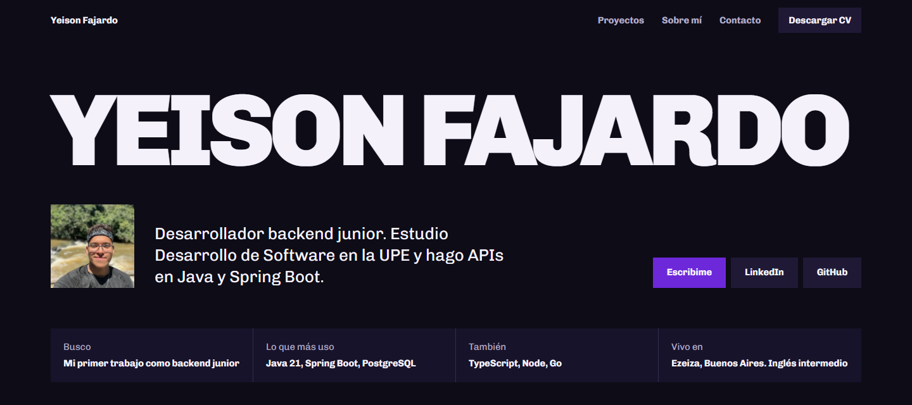
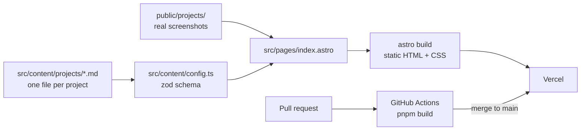

# Portfolio.yeison

[](https://portfolio-yeison.vercel.app/)

This is my portfolio: [portfolio-yeison.vercel.app](https://portfolio-yeison.vercel.app/).

I am looking for my first job as a junior backend developer (Java, Spring Boot, PostgreSQL).
The page shows a few projects and the story behind each one: why I built it and what surprised me while building it.

## How it works

Each project is one Markdown file in `src/content/projects/`. Astro checks the frontmatter with a schema, builds one static page, and Vercel serves it. There is no database and no JavaScript framework on the page.



- Featured projects (`featured: true`) get their own block: the story stays pinned on the left while the screenshots scroll on the right.
- The rest are one line each in "Otros proyectos".
- A private project has `privateNote` instead of a GitHub link. I mention it, but the code stays private.
- "Escribime" opens Gmail's compose window in a new tab with my address already filled in, not the computer's mail app.

## Add a project

```bash
node scripts/add-project.mjs <repo-name> [--featured]
```

It reads the repo with `gh` and creates the Markdown file. Then I write the story and add real screenshots to `public/projects/`.

## Tech

- **Framework:** Astro 4 (content collections)
- **Styles:** plain CSS, one font (Chivo, self-hosted with Fontsource)
- **Language:** TypeScript
- **Package manager:** pnpm 10
- **CI:** GitHub Actions builds every pull request
- **Hosting:** Vercel

## Run it

```bash
pnpm install
pnpm dev
```

## Contact

- [LinkedIn](https://www.linkedin.com/in/yeison-fajardo)
- [GitHub](https://github.com/Yeisonfjrd)
